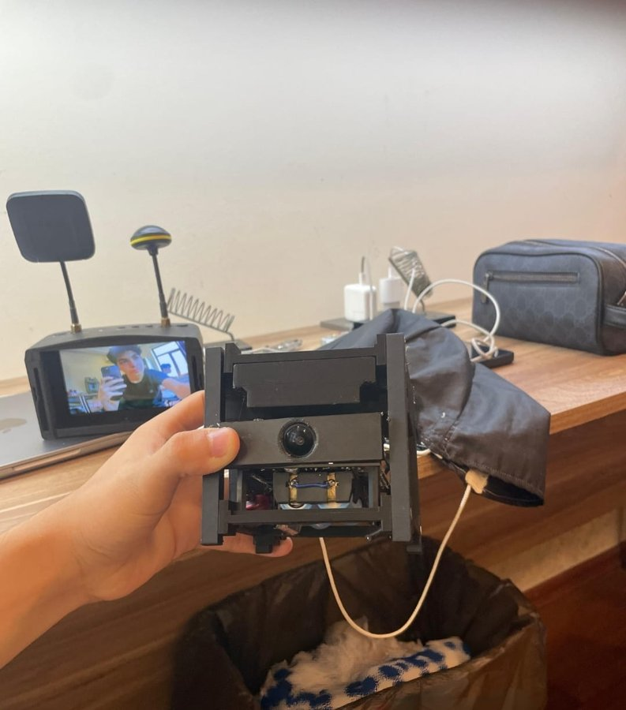
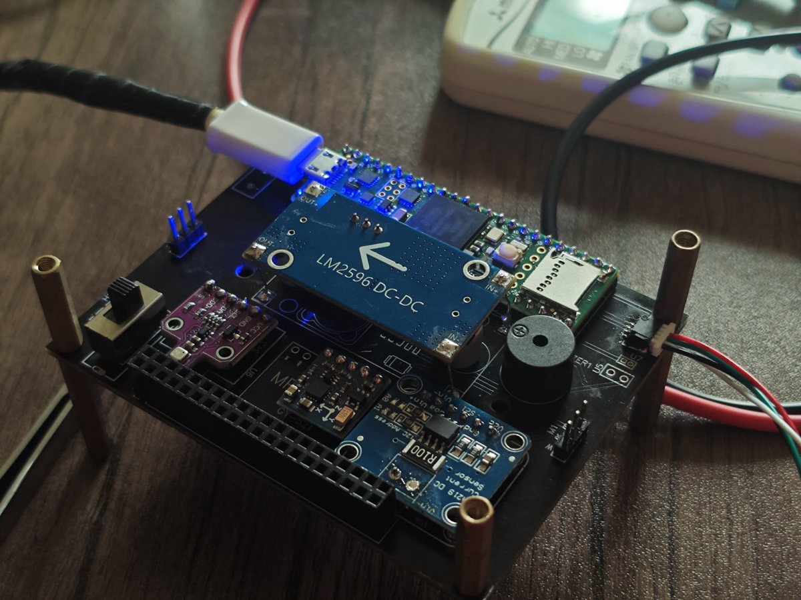
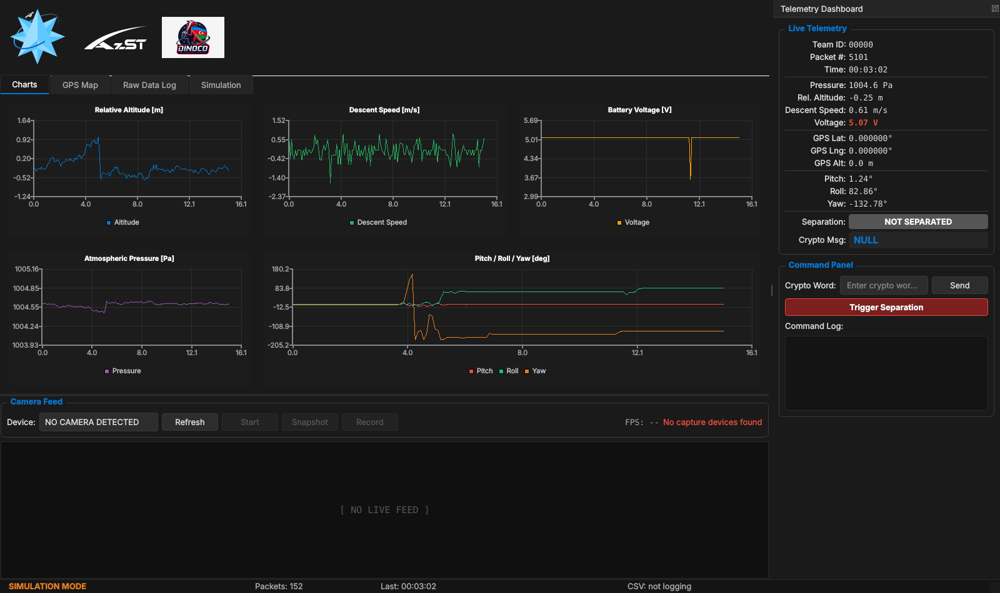

<h1 align="center">CubeSat — Flight Software & Ground Stations</h1>

<p align="center">
  The flight firmware, LoRa telemetry link and desktop ground-station apps I wrote<br>
  for a competition CubeSat, across several editions of the project.
</p>

<p align="center">
  
  
  
  
  
</p>

---

<table>
  <tr>
    <td width="40%"></td>
    <td width="60%"></td>
  </tr>
  <tr>
    <td><sub>The assembled CubeSat streaming live video from its onboard camera to an FPV receiver.</sub></td>
    <td><sub>Flight computer: a Teensy 4.1 on a custom carrier PCB, with a buck regulator and sensor breakouts.</sub></td>
  </tr>
</table>

## Competitions

- **STEAM Azerbaijan Festival**: 2024 and 2025
- **Aerokosmik Modelling Festival**
- **NASA Space Apps Challenge**: 2024

This was a team project. This repository contains only my part: the flight firmware and both ground-station applications.

## Overview

The CubeSat streams telemetry once per second over a LoRa radio link to a ground station.
It reports orientation, pressure altitude, descent speed, battery voltage and GPS position.
The ground station decodes, plots, maps and logs every packet.

```
┌──────────────── CubeSat ────────────────┐            ┌───────────── Ground ─────────────┐
│ BNO086 IMU ─┐                           │            │                                  │
│ BMP280 ─────┼─ I²C ─┐                   │   LoRa     │  E30 ── Arduino Nano ── USB ──┐   │
│ BN220 GPS ── UART2 ─┤   Teensy 4.1 ── UART7 ── E30 ~~~~~~~~~~~~~ E30                 │   │
│ Battery ──── A0 ────┘      │            │  170 MHz   │                    Qt6 ground   │   │
│                       SD card (CSV)     │            │                    station app ◄┘   │
└─────────────────────────────────────────┘            └──────────────────────────────────┘
```

## Repository layout

| Path | What it is |
|---|---|
| [`firmware/flight_computer/`](firmware/flight_computer) | Integrated Teensy 4.1 flight firmware (3rd edition) |
| [`firmware/ground_station_receiver/`](firmware/ground_station_receiver) | Arduino Nano + E30: configures the radio, forwards packets to USB |
| [`firmware/bringup/`](firmware/bringup) | One-sensor-at-a-time test and configuration sketches used during development |
| [`ground-station/v3-qt/`](ground-station/v3-qt) | 3rd edition ground station: Qt6 / C++17 desktop app |
| [`ground-station/v2-python/`](ground-station/v2-python) | 2nd edition ground station: Python / PyQt6 serial logger |
| [`docs/telemetry-format.md`](docs/telemetry-format.md) | Packet format specification |
| [`docs/sample-data/`](docs/sample-data) | Real logs from bench tests of both editions |

## Hardware (3rd edition)

| Function | Part | Interface |
|---|---|---|
| Flight computer | Teensy 4.1 | — |
| Orientation | BNO086 9-DoF IMU (on-chip sensor fusion) | I²C, address `0x4B` |
| Pressure / altitude | BMP280 | I²C, `0x76` / `0x77` |
| Position & UTC time | BN220 GPS | `Serial2`, 9600 baud, NMEA |
| Radio | Ebyte E30-170T20D (170 MHz, 20 dBm) | `Serial7`, 9600 baud |
| Battery | 2S Li-ion (6.0–8.4 V) through a resistor divider | `A0`, 12-bit ADC |
| Storage | Teensy built-in micro-SD | SDIO |
| Ground receiver | Arduino Nano + E30 | SoftwareSerial D2/D3, M0/M1 on D4/D5 |

## Flight firmware highlights

- **Fault-tolerant start-up.** A missing or failed sensor doesn't halt the boot. The firmware keeps transmitting, and the affected field stays at zero, so the ground station shows which subsystem dropped out. This came out of debugging a board that worked on USB power but misbehaved on battery.
- **Relative yaw.** The BNO086 rotation-vector quaternion is converted to Euler angles. Yaw is zeroed to the start-up heading, after discarding the first 10 readings while the sensor settles.
- **Persistent IMU calibration.** Send `s` over USB serial to store the BNO086's dynamic calibration in its flash (`sh2_saveDcdNow()`).
- **Ground-referenced altitude.** 50 pressure samples are averaged at boot to set ground zero. Descent speed is derived from the altitude change over time.
- **Packet counter survives reboots.** It's stored in the Teensy's emulated EEPROM.
- **Crash-safe logging.** Every packet is appended to `<TEAM_ID>.csv` on the SD card and flushed right away, so data survives a hard landing or a power cut.
- **GPS time with a fallback.** The timestamp uses GPS UTC once a fix is acquired, and an elapsed-time counter before that.

## Ground station (3rd edition, Qt6)


<sub>Replaying a real bench-test log (`docs/sample-data/v3-bench-test.csv`) in Simulation mode.</sub>

- Serial connection with background port scanning, so the UI never freezes on Windows.
- Robust parser for the 15-field packet, with per-field error reporting.
- Live charts for altitude, descent speed, battery voltage, pressure, and pitch/roll/yaw.
- Offline GPS track view drawn with `QPainter`, so no map tiles or internet are needed in the field.
- Automatic CSV logging per team ID.
- **Simulation mode:** replays any recorded log at 0.5×–10× speed through the same pipeline as live data.
- Live analog camera feed from a VTX receiver (shows up as a UVC webcam), with snapshot and recording.
- Battery level and separation-status indicators.

Build instructions are in [`ground-station/v3-qt/README.md`](ground-station/v3-qt/README.md).

## Project history

| Edition | Ground station I built | Telemetry |
|---|---|---|
| **2nd** (late 2025) | Python / PyQt6 serial logger with auto-plotting | JSON packets: temperature, humidity, pressure, gas, accelerometer/gyro, servo state, GPS |
| **3rd** (2026, mission *Kripto*) | Native Qt6 / C++ app with charts, map, CSV replay and a live camera feed | Fixed 15-field competition CSV over LoRa from a Teensy 4.1 |

The 2nd edition flight firmware isn't included in this repository.

## Engineering notes

- **LoRa packet loss.** During testing, a one-shot uplink message was received only about 2 times in 10. I added an ACK/retry scheme for it: the ground station repeats until the CubeSat acknowledges, and the CubeSat re-ACKs duplicates. The crypto-message feature that needed the uplink was later dropped from the mission scope, so the current firmware is downlink-only and `CRYPTO_MSG` is sent as `NULL`.
- **Serial line framing.** `readStringUntil()` returns partial data on timeout, so the receive path needs to buffer bytes and only accept complete newline-terminated lines.

## Status / roadmap

- [x] IMU, barometer, GPS, battery and SD logging integrated in one firmware
- [x] LoRa downlink and Qt ground station
- [ ] `SEPARATION` field: sensing not yet integrated (sent as `0`)
- [ ] Uplink commands: the ground station's *Send* and *Trigger Separation* controls are UI-only for now
- [ ] Migration to the Ebyte E22-900T22D radio

## License

[MIT](LICENSE)
